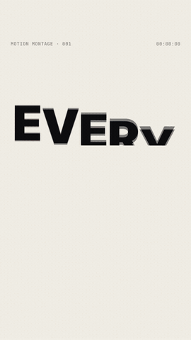
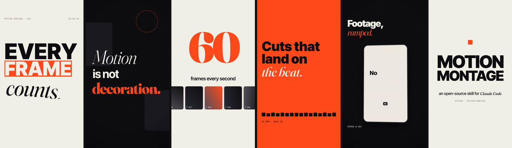

<div align="center">

# Motion Montage

**A motion-design studio in a skill.**
Kinetic typography, montage edits, transitions, camera moves, motion blur and sound design,
rendered entirely from code by a team of AI agents with an independent critic.

 &nbsp;


*The `showreel` template: 16 s, 9:16, 60 fps, motion blur, 5 transition types, synthesised score and SFX. Zero editing apps.*

</div>

---

## Why

Most "AI video" looks like AI: small text sliding around, one transition on repeat, dead frames, no motion blur, music fighting the voice.
Motion Montage encodes what a senior motion designer and editor do by reflex, then **measures** the result:

| Pro reflex | How it's built in |
|---|---|
| Fill the frame and use scale contrast | `MM.text.fit()`, a layout probe that flags off-frame, unsafe and colliding text |
| Ease, stagger, overlap and settle | An easing vocabulary chosen by intent (`snap`, `glide`, `whip`, `exit`), closed-form springs, stagger patterns |
| A camera that's never dead | Parallax depth layers, push-ins, seeded handheld drift |
| Motion blur | True sub-frame shutter (`--shutter 2/4`) plus velocity-based directional blur |
| Cuts that land on the word or beat | Whisper word timestamps → `MM.at('word')`; a beat grid from the music |
| Transitions chosen by meaning | 12 types (whip, zoom, slats, sweep, stack, iris, …) and an editor agent that never repeats one back-to-back |
| Sound with weight | Synthesised bed + 9 SFX types fired from picture cues, ducking, two-pass −14 LUFS |
| A tough reviewer | `qc_video.py` detects **dead air**, loudness, sync drift and cuts; the critic agent scores 8 categories and blocks delivery below 8/10 |

## The studio

| Agent | Role |
|---|---|
| `montage-director` | Brief, treatment and style lock, gates, ship/loop decision |
| `montage-timing` | Voice clean-up → word timestamps → script alignment, beat grid, cut points |
| `montage-storyboard` | A scene board: focal point, layout, type scale, enter/life/exit, transition, SFX |
| `montage-motion` | Builds the deterministic composition with the engine |
| `montage-editor` | Cut list, transitions by meaning, pacing, match cuts, sound bridges |
| `montage-sound` | Music bed, SFX, ducking, mastering |
| `montage-critic` | Independent QC with instruments and eyes, then a scored fix list |

```
voice/music/footage → TIMING → STORYBOARD → BUILD → STILLS GATE → RENDER → SOUND → CRITIC → deliver
                                                   ▲                                   │
                                                   └──────────── fix list ◄────────────┘
```

## Install

**As a Claude Code plugin** (skill + agents):
```bash
claude plugin marketplace add aeasyihub-cyber/motion-montage
claude plugin install motion-montage@motion-montage
```

**As a standalone skill** (Claude Code, or any agent that reads `SKILL.md`):
```bash
git clone https://github.com/aeasyihub-cyber/motion-montage
cp -r motion-montage/skills/motion-montage ~/.claude/skills/
cp motion-montage/agents/*.md ~/.claude/agents/          # optional: the studio agents
```

**Engine dependencies** (once):
```bash
cd skills/motion-montage/engine
npm install && npx playwright install chromium
pip install numpy scipy faster-whisper     # scipy optional (faster), whisper only for voice mode
# ffmpeg must be on PATH
```

## Use

Just ask:

> *"Make a 30 s kinetic reel from my voice note `pitch.m4a` with this script… brand colours #… logo attached."*
> *"Cut a 20 s beat-synced promo for our app to `track.mp3` using these 6 screenshots."*
> *"Here's my old reel. Make it look like a pro motion designer did it."*

Or drive the engine yourself:

```bash
E=skills/motion-montage/engine
bash $E/new_project.sh my-film showreel                       # or voice-kinetic
node $E/render.mjs --comp my-film/composition.html --every 0.5     # contact sheet
node $E/render.mjs --comp my-film/composition.html --qc            # layout probe
node $E/render.mjs --comp my-film/composition.html --shutter 2     # final, with motion blur
python3 $E/audio/sound.py bed --dur 16 --bpm 96 --out bed.wav
python3 $E/audio/sound.py sfx --cues my-film/out/cues.json --out sfx.wav
python3 $E/audio/sound.py mix --bed bed.wav --sfx sfx.wav --out mix.wav
python3 $E/audio/sound.py mux --video my-film/out/video-silent.mp4 --audio mix.wav --out final.mp4
python3 $E/qc/qc_video.py final.mp4 --sheet qc.png
```

## Writing a scene

```js
// every value is a function of t; the voice is the clock
T.onWords(words, t, times([['Every'], ['motion']]), 'rise');          // each word lands on its spoken onset
T.highlight($('#hl'), t, MM.at('code') + 0.05);                        // marker grows when "code" is said
MM.camera($('#s3'), { zoom: kf(t, [[s, 1.0], [e, 1.05, ease.glide]]) }); // push-in, parallax for free
MM.edit(t, SCENES, [{ type: 'whip', dur: 0.32, dir: 'left' }, { type: 'zoom', dur: 0.55 }]);
```

See [`skills/motion-montage/references/engine-api.md`](skills/motion-montage/references/engine-api.md).

## Repo layout

```
.claude-plugin/        plugin + marketplace manifests
agents/                7 studio agents
skills/motion-montage/
  SKILL.md             the pipeline and gates
  references/          motion grammar, transitions, typography, layout, rhythm, sound, voice, presets, QC rubric
  engine/              render.mjs · lib/ (motion, stage, text, transitions) · audio/ · voice/ · qc/
  templates/           voice-kinetic · showreel
examples/              a script with #markers and *emphasis*
```

## Requirements and performance

Node ≥ 18, Python ≥ 3.9 with numpy, and ffmpeg. Speed is about 2.5–3 frames/s per CPU core at 1080×1920. A 16 s film at 60 fps with `--shutter 2` renders in about 7 min on 2 cores and about 2 min on 8.

## Credits and licence

MIT © 2026 [AEasyI](https://www.instagram.com/theaeasyi). Fonts in the templates are SIL OFL (Inter Tight, Fraunces, JetBrains Mono).
Inspired by the craft of After Effects artists, and by Remotion and HeyGen's HyperFrames (see `references/prior-art.md`).
Use only voices, music, footage and logos you have the rights to.
